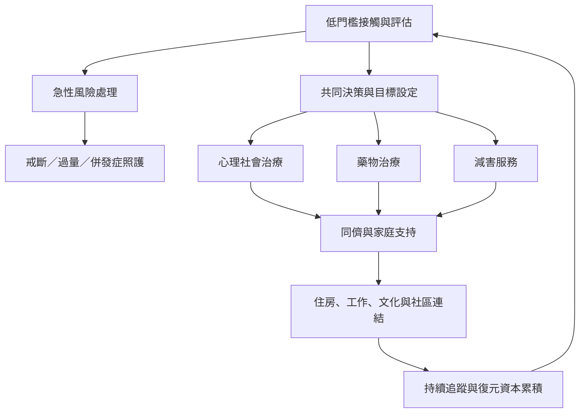

照護需要同時處理急性醫療風險、持續治療、社會條件與生活重建。減害可以在停止使用之前保護生命；復元服務則要有多種入口，避免把單一路徑當成所有人的標準。

這是服務網絡而非單向階段；個人可能同時使用多項服務，也可能在不同時點更改目標。

可連結[[減害]]、[[阿片類促效劑治療]]、[[納洛酮]]、[[心理治療]]、[[同儕復元支持]]、[[治療可近性]]與[[復元資本]]。

## 參考
* [[WHO與UNODC治療標準主張以倫理及證據建立整合照護]]。
* [[WHO指出阿片類促效劑治療應被視為持續性的基本健康服務]]。
* [[SAMHSA將復元定義為多路徑的個人改變歷程]]。

回到[[Addiction]]。
