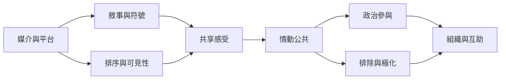

媒介不只是情緒訊息的傳遞管道，也會透過平台設計、敘事形式、節奏與可見性改變群體如何感受與行動。情動公共與情感經濟可以解釋網絡團結如何形成，也提醒我們共享感受不保證組織持續、資訊可靠或權力平等。

## 關係圖

## 概念連結
* [[Papacharissi 說明社群媒體如何組成情動公共]]、[[公共感受沙龍呈現情緒如何構成政治歸屬]]
* [[數位平台讓共享感受形成短暫而可見的公共]]、[[情感經濟透過符號流通製造群體邊界]]
* [[從情動公共區分網路共鳴與實際互助能力]]

## 參考
* [[Papacharissi 說明社群媒體如何組成情動公共]]、[[情動研究必須把理論主張帶回可觀察的經驗場景]]。
