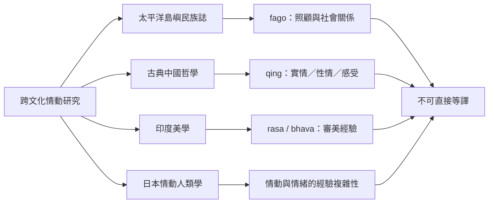

跨文化情動研究不應把西方理論當作通用量尺，再將其他地方的情緒詞當成待翻譯的資料。Ifaluk 的 fago、印度的 rasa／bhāva、古典中國的情等概念，都涉及不同的身體觀、倫理關係與知識傳統。比較可以建立對話，但要保留語義差異與歷史脈絡。

## 關係圖

## 概念連結
* [[Lutz 的 Ifaluk 民族誌挑戰西方情緒觀的普遍化]]、[[早期中國哲學的情字涵義超出現代情緒分類]]
* [[印度 rasa 美學提供不同於西方情緒心理學的理論資源]]、[[日本情動人類學提醒研究者不要把情動和情緒硬性二分]]
* [[地方情緒詞彙不能被直接翻譯成普遍心理類別]]、[[情不只是內在感受也可能指向實情與世界關係]]

## 參考
* [[地方情緒詞彙不能被直接翻譯成普遍心理類別]]、[[早期中國哲學的情字涵義超出現代情緒分類]]。
