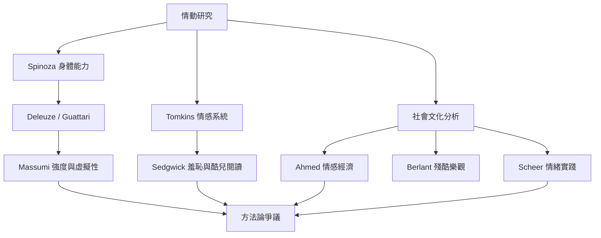

情動理論至少由幾條路線交織而成：Spinoza—Deleuze—Massumi 的身體能力與強度路線、Tomkins—Sedgwick 的情感心理學與酷兒閱讀路線，以及 Ahmed、Berlant、Scheer 等人對情緒社會性、歷史性與權力作用的分析。理解譜系時，重點不是把差異消除，而是辨認各路線的研究問題與證據類型。

## 關係圖

## 概念連結
* [[情動理論至少包含兩條不可互換的思想譜系]]、[[斯賓諾莎以身體受影響與影響他人的能力理解情動]]、[[Massumi 將情動描述為身體感受與行動潛能的強度變化]]
* [[Tomkins 的情感心理學讓羞恥成為理解自我關係的關鍵]]、[[Sedgwick 以修復式閱讀拓展情動研究的倫理可能]]
* [[情動與情緒的區分應當視為分析工具而非普遍階序]]、[[Leys 的批判要求情動理論說清楚認知與意向性的地位]]

## 參考
* [[情動理論至少包含兩條不可互換的思想譜系]]、[[Leys 的批判要求情動理論說清楚認知與意向性的地位]]。
