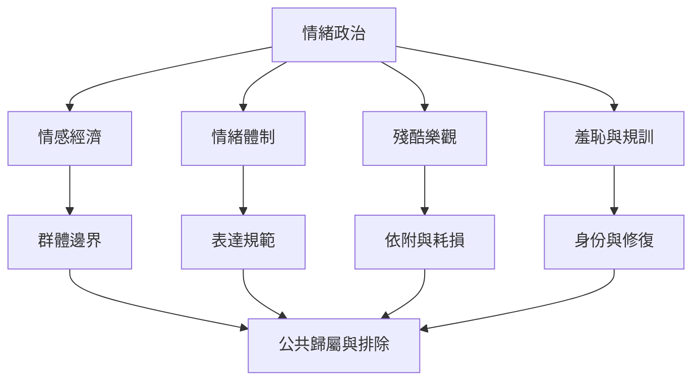

情緒政治研究情緒如何參與身份、國族、種族、性別、階級、殖民關係與政策正當性。Ahmed 的情感經濟分析符號如何黏附群體，Berlant 的殘酷樂觀分析生活依附與資本主義承諾，Reddy 的情緒體制則揭示制度如何規範表達。此路線使私人感受成為理解公共權力的入口。

## 關係圖

## 概念連結
* [[Ahmed 指出情緒會在身體符號與公共敘事之間流通]]、[[Reddy 的情緒史揭示政治制度會規定可感受的範圍]]
* [[Berlant 以殘酷樂觀描述讓人受困的希望關係]]、[[Tomkins 的情感心理學讓羞恥成為理解自我關係的關鍵]]
* [[情緒政治需要追問誰有權命名與分配感受]]、[[情緒體制決定哪些感受能被公開表達]]

## 參考
* [[情緒政治需要追問誰有權命名與分配感受]]、[[情感經濟透過符號流通製造群體邊界]]。
