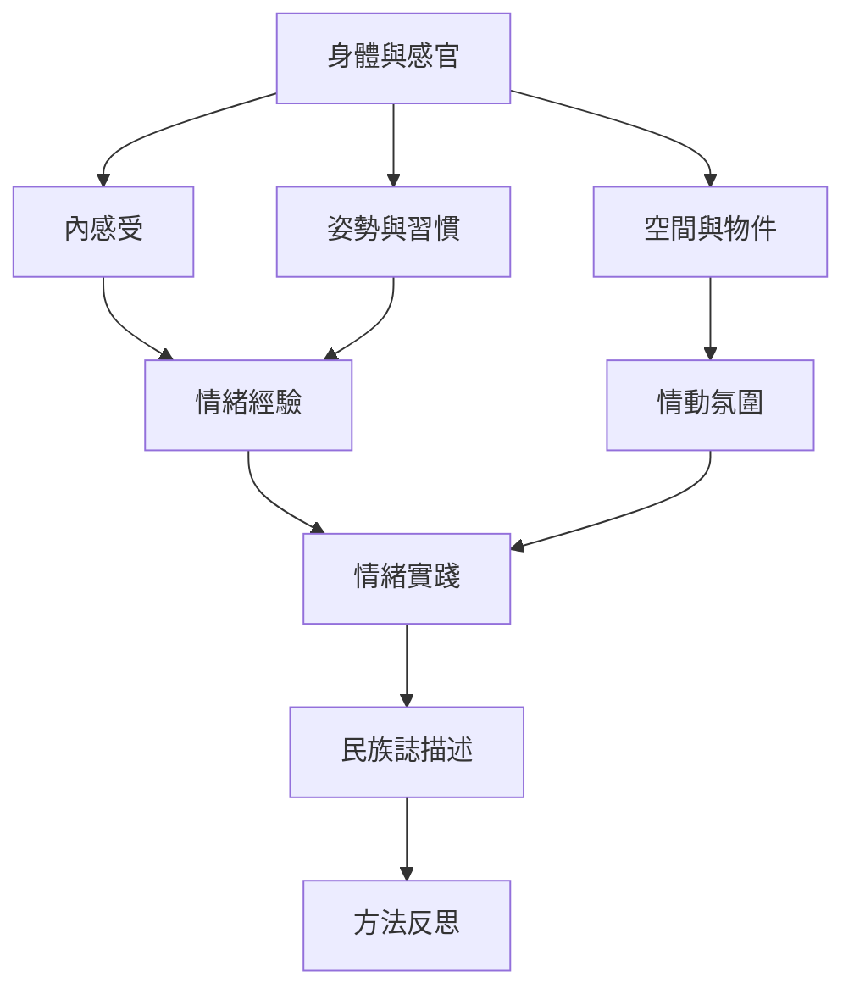

情動不只發生在抽象的內在心理，也出現在呼吸、姿勢、節奏、空間、物件、聲音與互動中。身體化實踐研究、情動氛圍研究與民族誌可以共同說明情緒如何在具體日常中生成。研究者需同時分辨身體觀察、當事人敘述與理論推論。

## 關係圖

## 概念連結
* [[身體不是情緒的容器而是關係中的行動者]]、[[情緒是在身體化實踐中生成而不只是被表達]]
* [[情動氛圍是由身體空間物件與互動共同形成]]、[[民族誌情動研究需要讓難以言說的感受進入描述]]
* [[情緒經驗可能由身體訊號與概念預測共同建構]]、[[研究情緒需要同時觀察語言身體物件與制度]]

## 參考
* [[Scheer 將情緒視為身體化的社會實踐]]、[[民族誌情動研究需要讓難以言說的感受進入描述]]。
