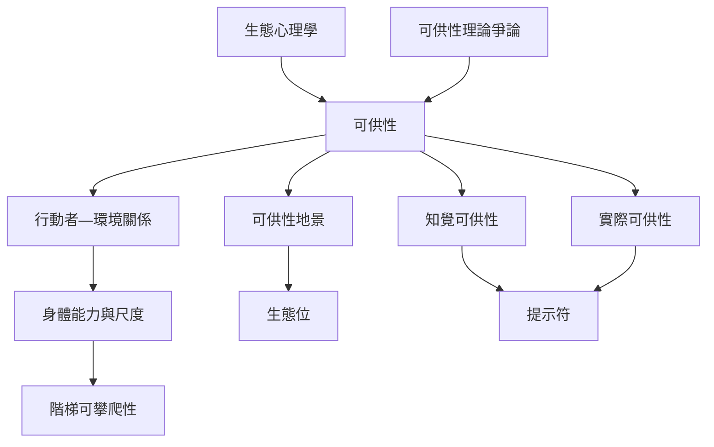

本地圖整理可供性理論的核心問題：環境如何提供行動可能、這些可能如何依行動者的身體能力而變化，以及知覺如何引導行動。Gibson 的生態心理學提供出發點，Chemero 的關係論讓理論更明確，Warren 的階梯研究則展示身體比例如何影響可攀爬性。閱讀時要保留理論版本間的差異。

## 概念連結
* [[可供性]]
* [[生態心理學]]
* [[行動者—環境關係]]
* [[知覺可供性]]
* [[實際可供性]]
* [[提示符]]
* [[身體化認知]]
* [[生態位]]
* [[可供性地景]]
* [[可供性理論存在不同定義與爭論]]
* [[data/切梅羅將可供性界定為能力與環境特徵之間的關係]]
* [[data/可供性理論把環境理解為行動者可採取行動的可能性集合]]
* [[data/華倫以階梯研究展示可供性知覺與身體比例的關係]]

## 延伸閱讀
* [[可供性理論把環境理解為行動者可採取行動的可能性集合]]
* [[切梅羅將可供性界定為能力與環境特徵之間的關係]]
* [[華倫以階梯研究展示可供性知覺與身體比例的關係]]
* [[可供性是行動者與環境之間的關係]]
* [[同一環境會因身體能力不同而提供不同可供性]]

* 導讀：[[Affordance]]
