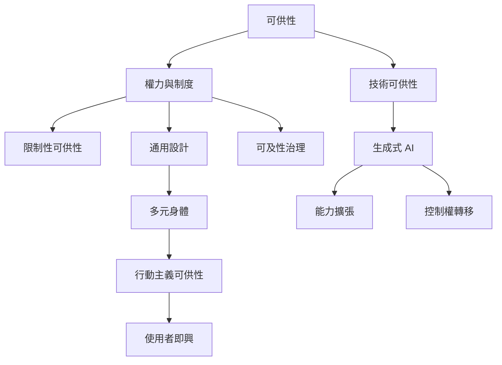

本地圖從批判與政治面向整理可供性。環境如何提供行動可能，與誰被當成標準使用者、誰能取得資源、誰被限制參與密切相關。障礙者的即興實踐能揭露設計盲點；通用設計需要處理多元身體的知識與權力；生成式 AI 則帶來能力擴張與控制權轉移的新問題。

## 概念連結
* [[可供性]]
* [[限制性可供性]]
* [[通用設計]]
* [[行動主義可供性]]
* [[技術可供性]]
* [[可供性地景]]
* [[data/哈姆萊以通用設計史追問誰被算作所有人]]
* [[data/戴維斯提出分析科技可供性的機制與條件框架]]
* [[data/多庫馬奇以障礙者即興實踐提出行動主義可供性]]

## 延伸閱讀
* [[哈姆萊以通用設計史追問誰被算作所有人]]
* [[多庫馬奇以障礙者即興實踐提出行動主義可供性]]
* [[戴維斯提出分析科技可供性的機制與條件框架]]
* [[生成式 AI 擴大表達可能也可能轉移控制權]]
* [[用障礙者的即興策略反向檢查設計盲點]]

* 導讀：[[Affordance]]
