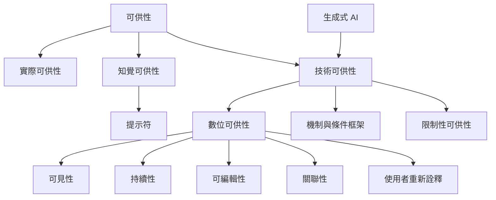

本地圖關注可供性概念如何從生態心理學進入設計與科技研究。設計領域需區分實際可供性、知覺可供性與提示符；科技社會學則提醒我們，同一技術的行動可能會被組織規則、平台架構與使用者實踐重新形塑。可見性、持續性、可編輯性與關聯性是分析社群媒體的重要切入點。

## 概念連結
* [[可供性]]
* [[實際可供性]]
* [[知覺可供性]]
* [[提示符]]
* [[技術可供性]]
* [[數位可供性]]
* [[限制性可供性]]
* [[機制與條件框架]]
* [[可供性的實現]]
* [[data/唐納·諾曼提醒設計者區分實際可供性與知覺可供性]]
* [[data/微信拍一拍研究顯示使用者會重新詮釋平台可供性]]
* [[data/生成式人工智慧研究重新檢視工具控制與行動能力的交換]]
* [[data/特里姆與萊昂納迪整理社群媒體的四種組織溝通可供性]]
* [[data/威廉·蓋佛將可供性帶入人機互動與介面設計]]

## 延伸閱讀
* [[唐納·諾曼提醒設計者區分實際可供性與知覺可供性]]
* [[威廉·蓋佛將可供性帶入人機互動與介面設計]]
* [[特里姆與萊昂納迪整理社群媒體的四種組織溝通可供性]]
* [[微信拍一拍研究顯示使用者會重新詮釋平台可供性]]
* [[生成式人工智慧研究重新檢視工具控制與行動能力的交換]]

* 導讀：[[Affordance]]
