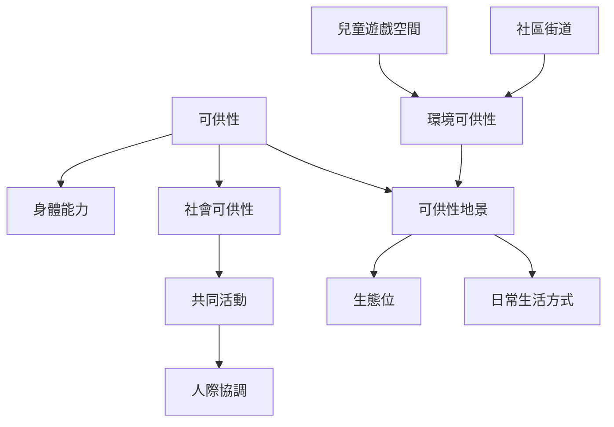

本地圖將可供性擴展到身體能力、共同活動與日常生活方式。行動不只由個人完成，也可能依靠他人、物件、節奏及空間配置。社會可供性能支持互助、照料與協作；可供性地景則呈現整個環境支持何種生活方式。

## 概念連結
* [[可供性]]
* [[社會可供性]]
* [[共同活動]]
* [[可供性地景]]
* [[生態位]]
* [[環境可供性]]
* [[身體化認知]]
* [[data/戶外遊戲空間回顧研究整理兒童遊戲可供性的環境特徵]]
* [[data/馬許等人從共同活動說明社會連結如何在協調中形成]]
* [[data/中國社區街道研究把兒童需求連結到環境可供性]]

## 延伸閱讀
* [[馬許等人從共同活動說明社會連結如何在協調中形成]]
* [[戶外遊戲空間回顧研究整理兒童遊戲可供性的環境特徵]]
* [[中國社區街道研究把兒童需求連結到環境可供性]]
* [[社會可供性來自人際協調的可能]]
* [[把共食活動設計成互助與共同注意的社會可供性]]

* 導讀：[[Affordance]]
