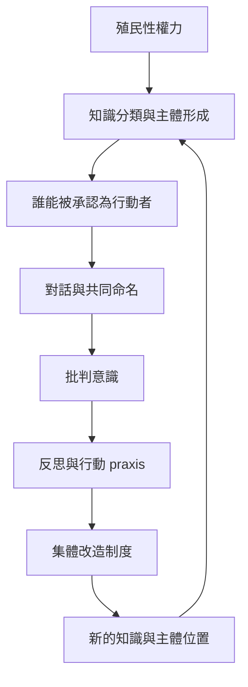

本圖將拉丁美洲解放教育與殖民性批判，連接到語言、知識生產、主體形成及集體行動。它補充前述女性主義與原住民知識脈絡，指出「誰能成為行動者」也受到知識秩序與殖民歷史影響。

延伸閱讀：[[殖民性]]、[[解放實踐]]、[[主體化]]、[[語言與制度決定哪些行動能被說出和承認]]、[[解放能動性需要共同生產知識並改造行動條件]]、[[弗雷勒將解放理解為受壓迫者參與的對話實踐]]、[[基哈諾的殖民性分析揭示主體形成與社會行動的歷史結構]]。

全書導讀：[[Agency_(philosophy)]]。
