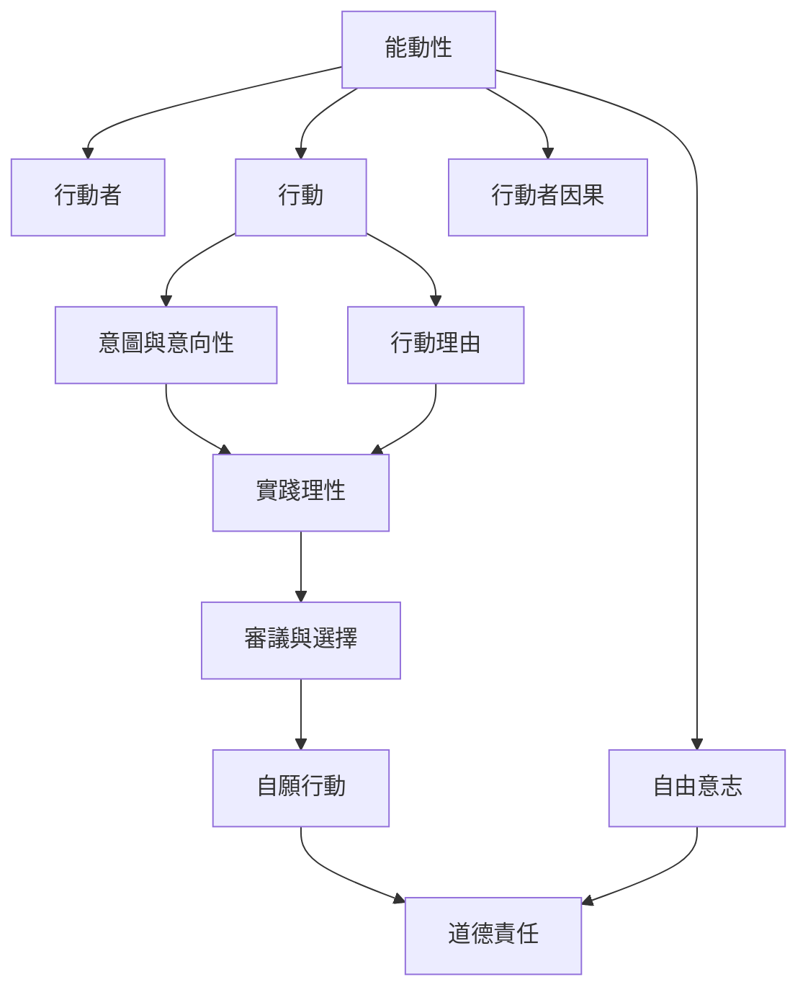

本圖聚焦行動哲學的基本問題：誰是行動者、何者算作行動、意圖與理由如何解釋行動，以及自由與責任如何建立。主流意向行動理論是重要起點，但不是能動性的唯一模型。

延伸閱讀：[[能動性]]、[[行動者]]、[[行動]]、[[意圖]]、[[意向性]]、[[行動理由]]、[[實踐理性]]、[[審議與選擇]]、[[自願行動]]、[[自由意志]]、[[道德責任]]、[[能動性不能被簡化為有意識的意圖]]、[[行動的理由使身體運動成為可理解的作為]]。

全書導讀：[[Agency_(philosophy)]]。
