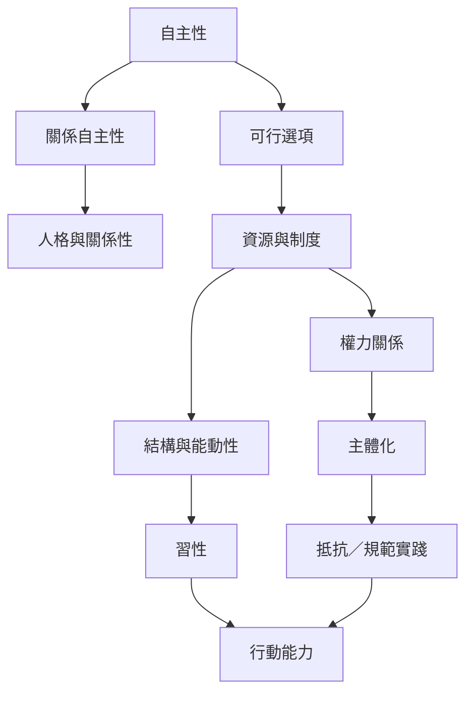

本圖追蹤個人自主如何受到資源、選項、關係與權力條件影響。它把自主性放回社會脈絡，而不是把自主理解成完全不受他人影響的孤立狀態。

延伸閱讀：[[自主性]]、[[關係自主性]]、[[人格與關係性]]、[[結構與能動性]]、[[習性]]、[[主體化]]、[[抵抗]]、[[自主性依賴支持性的關係與可行選項]]、[[社會結構既限制個體也由個體行動再生產]]、[[符合規範的實踐也可能是能動性的表現]]。

全書導讀：[[Agency_(philosophy)]]。
