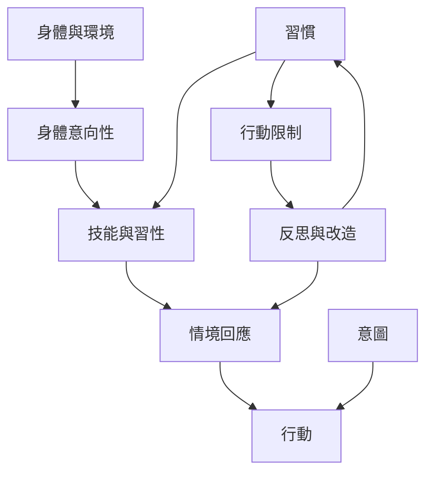

本圖呈現能動性如何透過身體技能、習慣與情境回饋實現。反思、意圖與計畫固然重要，但行動者也會透過身體熟練與環境互動直接回應情境。

延伸閱讀：[[身體意向性]]、[[習性]]、[[意圖]]、[[行動]]、[[身體技能構成反思選擇之前的行動基礎]]、[[習慣既保存行動能力也限制新的可能]]、[[把日常練習理解為培養可用行動能力的過程]]。

全書導讀：[[Agency_(philosophy)]]。
