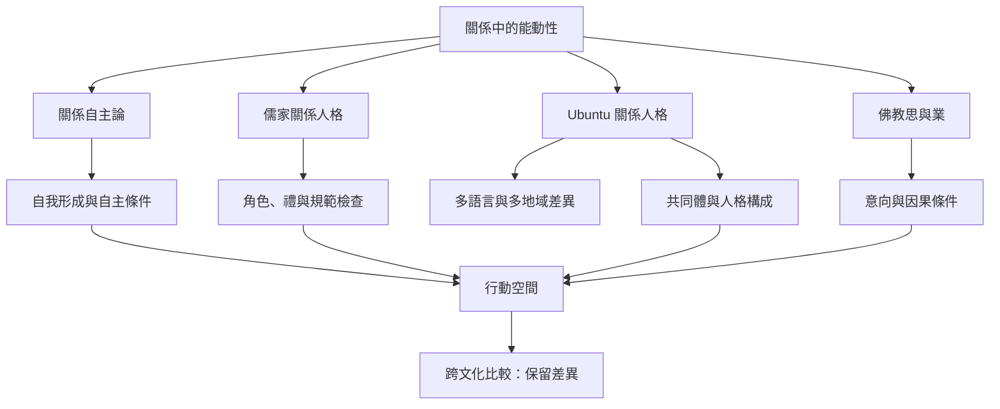

本圖以有限比較方式呈現關係自主、儒家角色倫理、Ubuntu 關係人格與佛教思／業論等材料。它們並非同義理論，而是對自我、意向、關係和行動條件提出不同問題的思想資源。

延伸閱讀：[[關係自主性]]、[[人格與關係性]]、[[Ubuntu]]、[[禮]]、[[思 cetana]]、[[因果與業]]、[[自主性依賴支持性的關係與可行選項]]、[[關係人格能支持能動性也可能固化權力]]、[[意向是因果歷程中的條件而非主權命令]]、[[跨文化比較應翻譯問題而非把能動性硬套成同義詞]]。

全書導讀：[[Agency_(philosophy)]]。
