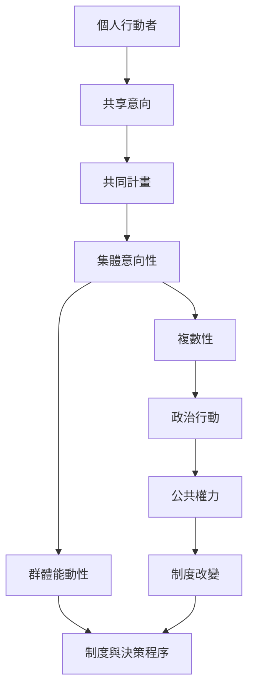

本圖從個人協作走向群體與政治行動。共同活動需要共享意向與相互協調；制度化組織可能成為群體行動者；政治行動則在複數者共同發起時創造公共權力。

延伸閱讀：[[集體意向性]]、[[群體能動性]]、[[複數性]]、[[布拉特曼以規劃結構說明共同能動性]]、[[李斯特與佩蒂特論群體能動者的制度條件]]、[[鄂蘭將政治行動理解為複數者共同開啟新開端]]、[[共同生活應讓參與者共同制定規則與修訂規則]]。

全書導讀：[[Agency_(philosophy)]]。
