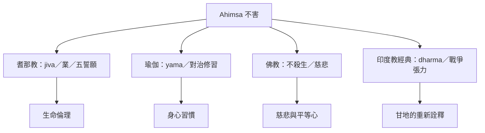

不害不是一條單線發展的教義，而是印度思想中多種宗教與修行傳統交會的概念。耆那教將其置於生命觀與解脫論中心；瑜伽把它列為第一項制戒；佛教以不殺生戒與不生敵意訓練行為和心；印度教經典則呈現不害與角色責任的張力。

耆那教的特殊性在於把生命視為遍在於不同形態；瑜伽經 2.34 將行為者、促成者與默許者一併納入反省；佛教則強調不殺生與不以恨止恨。相關概念包括 [[Ahimsa（不害）]]、[[耆那教（Jainism）]]、[[命（Jīva）]]、[[瑜伽制戒（Yama）]]、[[慈悲（Karuṇā）]] 與 [[平等心（Upekṣā）]]。

永久筆記：[[耆那教把不害視為解脫道路的核心誓願]]、[[印度教經典在不害與戰士責任之間保留難以消除的張力]]、[[佛教不害把戒行與心中不生敵意連在一起]]、[[不害不是零傷害的純潔競賽而是持續減害的實踐]]。

延伸閱讀：[[哈佛大學以跨宗教脈絡梳理不害思想與當代實踐]]、[[耆那教把不害置於五大誓願之首並延伸至各類生命]]、[[《瑜伽經》將不害列為修習道路的第一項制戒]]、[[佛教以不殺生戒與不以恨止恨培養不害]]。

返回總覽：[[Ahimsa]]。
