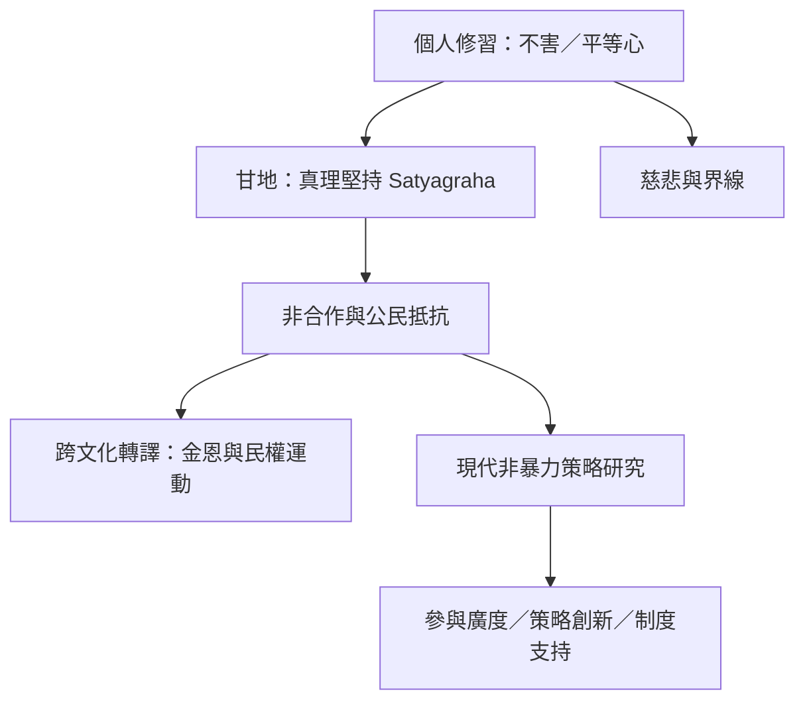

不害的現代意義之一，是把心念與日常行為訓練延伸到集體抵抗。甘地的 satyāgraha 將真理、自我紀律與不合作結合；金恩將甘地的方法與基督教之愛及美國黑人自由運動的組織傳統結合。當代研究則分析非暴力運動的參與、策略與成功條件。

此脈絡的關鍵是：不害可以支持抵抗，但非暴力行動不一定由宗教不害驅動；非暴力也不是被動忍耐。相關概念：[[薩提亞格拉哈（Satyagraha）]]、[[非暴力行動]]、[[公民抵抗（Civil Resistance）]]、[[慈心（Maitrī／Mettā）]]。

永久筆記：[[甘地把不害重新詮釋為真理追求與公共抵抗]]、[[非暴力行動不是被動不作為而是策略性地撤回合作]]、[[廣泛參與與策略多樣性是非暴力抵抗的重要力量]]、[[非暴力運動必須區分核心策略與暴力側翼的不同作用]]。

延伸閱讀：[[甘地的不害觀念是在政治實踐中逐步形成而非原封不動承襲古典傳統]]、[[金恩把甘地的非暴力方法轉譯成美國民權運動的集體實踐]]、[[非暴力抵抗的歷史資料顯示公民參與與制度支持是重要機制]]、[[Gene Sharp 將非暴力行動整理成抗議不合作與介入三大策略類型]]。

返回總覽：[[Ahimsa]]。
