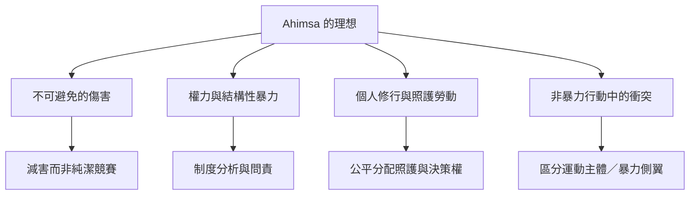

不害的當代應用必須面對幾個難題：完全不傷害是否可能？不抵抗是否會默許不義？非暴力運動中出現暴力事件時如何分析？修行共同體是否把照護成本轉嫁給女性或弱勢者？制度性傷害如何被看見與問責？本圖將這些問題作為持續校正倫理實踐的入口。

相關概念：[[Himsa（傷害）]]、[[結構性暴力（Structural Violence）]]、[[照護倫理]]、[[互賴]]、[[修復式正義]]。

永久筆記：[[不害不是零傷害的純潔競賽而是持續減害的實踐]]、[[慈悲與平等心能支持不報復但不等於縱容傷害]]、[[非暴力共同體需要透明分配照護工作與決策權]]、[[不害的實踐需要把修行者自身也納入照顧範圍]]。

延伸閱讀：[[用反思日誌分辨憤怒的訊息與報復的衝動]]、[[將不害設計成包含照護者的互助輪值制度]]、[[在數位生活中練習不擴散羞辱與仇恨]]。

返回總覽：[[Ahimsa]]。
