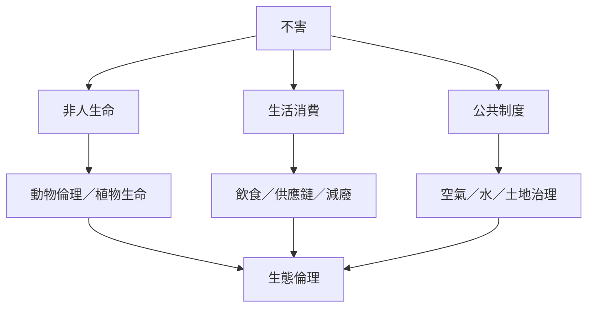

不害的倫理不應只關注人際衝突，也能延伸到動物、植物、土壤、水、空氣與生態系統。耆那教對生命形式的細緻注意與當代環境倡議，提供從個人飲食與消費到公共法規、河川治理和污染防治的連結。

此處需區分耆那教生命論與現代環境科學：兩者可以對話，但不能互相取代。相關概念：[[Ahimsa（不害）]]、[[命（Jīva）]]、[[不執取（Aparigraha）]]、[[生態倫理]]、[[互賴]]。

永久筆記：[[不害實踐需要把日常生活視為生命互賴網絡]]、[[不害可以從個人意圖擴展至制度與環境造成的傷害]]、[[不害的生態實踐需要從個人消費連到集體治理]]。

延伸閱讀：[[《阿查蘭伽經》與耆那經典把不傷害延伸到微小生命]]、[[用三層傷害盤點把不害帶進每日生活選擇]]、[[將不害落實為一份供應鏈減害清單]]、[[把環境不害轉成支持河川與空氣公共利益的行動]]。

返回總覽：[[Ahimsa]]。
