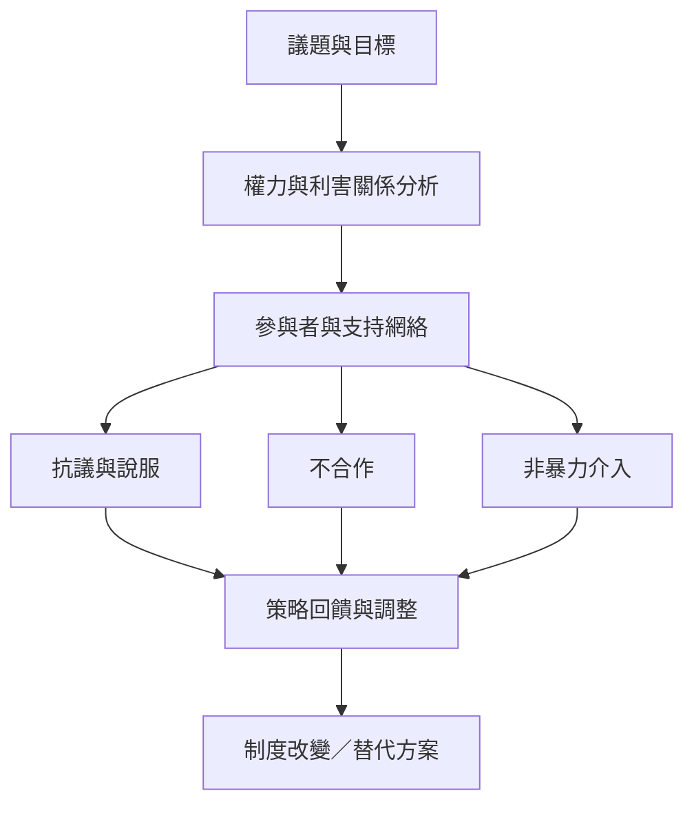

非暴力行動需要把價值轉為組織方法。策略可能包括抗議與說服、拒絕合作、罷工、抵制、建立替代制度和非暴力介入。有效性取決於目標、參與廣度、對權力依賴的理解、組織韌性與具體情境；它並非保證成功的公式。

相關概念：[[非暴力行動]]、[[公民抵抗（Civil Resistance）]]、[[薩提亞格拉哈（Satyagraha）]]、[[修復式正義]]。

永久筆記：[[非暴力行動不是被動不作為而是策略性地撤回合作]]、[[廣泛參與與策略多樣性是非暴力抵抗的重要力量]]、[[非暴力運動必須區分核心策略與暴力側翼的不同作用]]。

延伸閱讀：[[建立不以仇恨為燃料的社群衝突處理流程]]、[[將非暴力行動的工具箱轉成社區倡議路線圖]]、[[以非暴力溝通把真實表達與不傷害語言連在一起]]。

返回總覽：[[Ahimsa]]。
