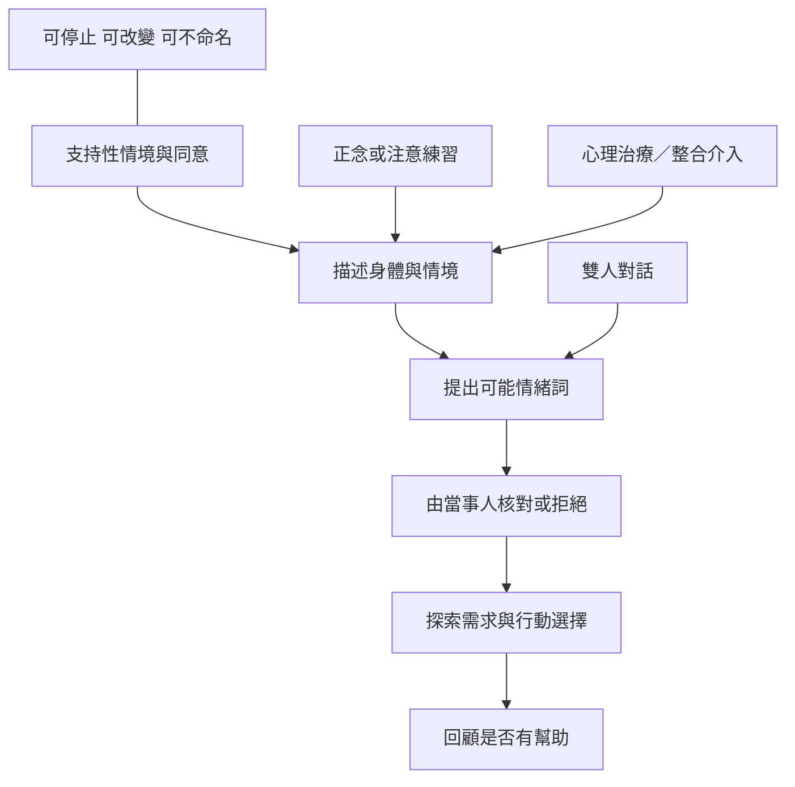

目前研究支持心理介入可能改善部分失感情指標，但尚未確立所有人都適用的單一方案。實務上可把身體訊號描述、情境探索、情緒詞彙、關係中的核對與選擇權整合成彈性流程。

## 概念連結
* [[情緒調節]]
* [[情緒標記]]
* [[失感情]]

## 永久筆記連結
* [[介入重點宜是建立可選擇的情緒覺察而非要求快速說出感受]]
* [[正念與雙人社會情緒練習都能改善部分失感情指標]]
* [[2026年統合分析顯示心理介入平均可降低失感情但尚未確立單一最佳療法]]
* [[人際理解應以好奇提問取代替他人判定內在狀態]]

## 參考
* [[Alexithymia]]
