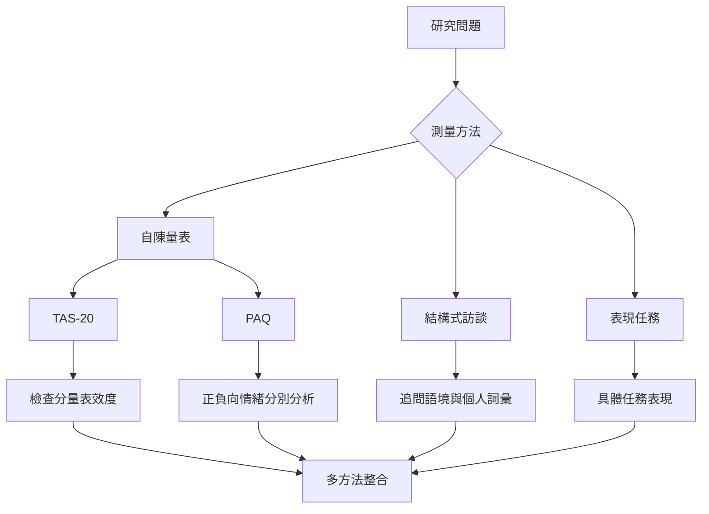

測量失感情時，應先釐清要測的是主觀自評、對情緒情境的表現，還是臨床訪談中的描述能力。TAS-20 與 PAQ 提供不同輪廓，但每種工具都受題目內容、文化語境、當下困擾與樣本特性限制。

## 概念連結
* [[多倫多失感情量表]]
* [[珀斯失感情問卷]]
* [[情緒覺察]]

## 永久筆記連結
* [[測量失感情需要結合自陳訪談與表現任務]]
* [[TAS20廣泛使用但部分分量表與題目存在效度疑慮]]
* [[PAQ能區分正向與負向情緒中的辨識及描述困難]]
* [[跨文化研究必須區分情緒困難與情緒表達規範]]

## 參考
* [[Alexithymia]]
