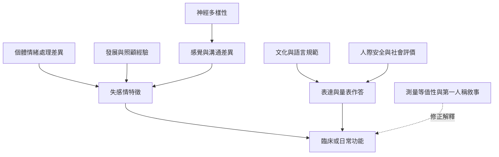

失感情不是脫離社會脈絡的個人缺陷。文化規範、語言、關係安全感、發展經驗與神經多樣性都可能影響人如何注意、表達與被評價。此地圖把跨文化心理計量、創傷發展研究與自閉症共現研究並列，避免單一成因論。

## 概念連結
* [[創傷]]
* [[自閉症]]
* [[失感情]]

## 永久筆記連結
* [[跨文化研究必須區分情緒困難與情緒表達規範]]
* [[創傷可能影響情緒學習但不能倒推出個人創傷史]]
* [[自閉症與失感情應分開描述以避免把神經多樣性病理化]]
* [[社會環境應提供情緒表達空間而不是要求個人單方面適應]]

## 參考
* [[Alexithymia]]
