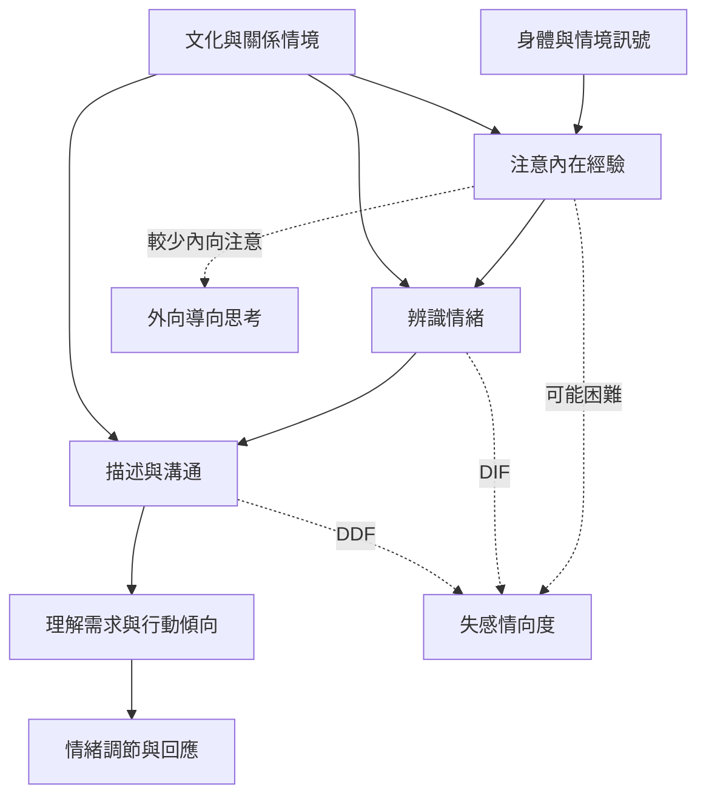

失感情應被理解為一組可分離、可變動的情緒處理向度，而不是「沒有情緒」。本圖把身體訊號、情緒注意、辨識、描述與調節放進同一歷程，並保留文化、發展與情境對各步驟的影響。

## 概念連結
* [[失感情]]
* [[情緒]]
* [[內感受]]
* [[情緒覺察]]
* [[情緒調節]]
* [[情緒粒度]]
* [[失體感症]]

## 永久筆記連結
* [[失感情不是沒有情緒而是情緒經驗難以被辨認與表述]]
* [[情緒覺察應拆成注意辨識描述與理解不同步驟]]
* [[內感受是情緒覺察的素材但不是情緒本身]]
* [[失感情的核心向度是難以辨識情緒難以描述情緒與外向思考]]

## 參考
* [[Alexithymia]]
