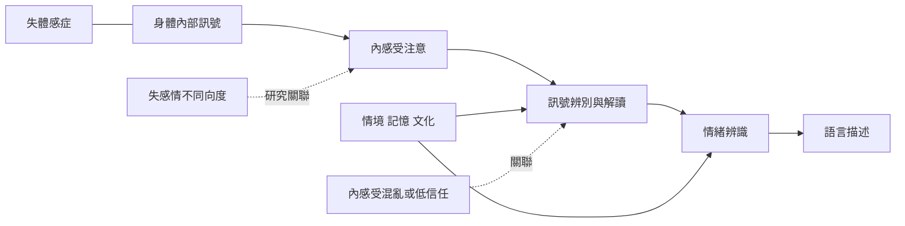

內感受研究讓失感情不再只被理解為詞彙不足。身體訊號的注意、準確度、解讀、信任與調節是可分離的面向；神經科學研究也提示不同向度可能涉及不同的認知與神經歷程。圖中箭頭表示研究假說中的關聯，不代表單向因果。

## 概念連結
* [[內感受]]
* [[失體感症]]
* [[失感情]]
* [[情緒覺察]]

## 永久筆記連結
* [[內感受是情緒覺察的素材但不是情緒本身]]
* [[主觀內感受與失感情的關聯會隨測量工具而改變]]
* [[身體覺察練習需要避免把每個身體訊號解碼成固定情緒]]

## 參考
* [[Alexithymia]]
