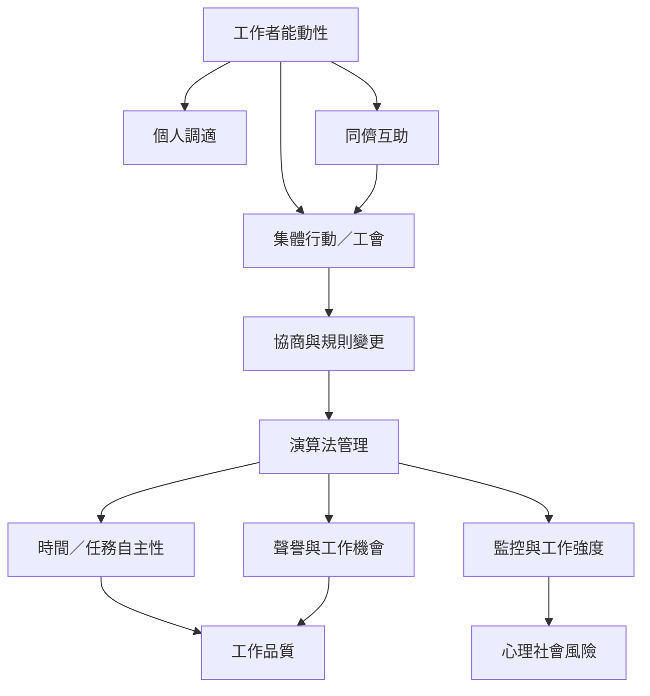

演算法管理對工作者的影響不只體現在收入，也包括時間與任務自主性、工作強度、心理社會風險、同儕關係及集體行動。工作者會透過個人策略、同儕互助與組織行動回應平台與雇主的規則；這些行動也可能反過來被組織觀察與調整。

本圖串聯[[工人自主性]]、[[工作品質]]、[[心理社會風險]]、[[演算法行動主義]]、[[集體協商]]與[[工會]]。地區案例可讀[[台灣487名定位型平台工作者調查連結勞動控制與心理福祉]]、[[印度海德拉巴外送平台田野研究揭示遠端監督與計件勞動]]與[[巴西坎皮納斯百名外送員訪談呈現演算法不透明與集體抵抗]]。

## 參考
* [[中國長沙外送員問卷研究發現演算法管理對風險行為存在雙重路徑]]；[[ILO研究指出平台工作者需要以集體協商縮小演算法資訊落差]]。
* [[Algorithmic_management]]。