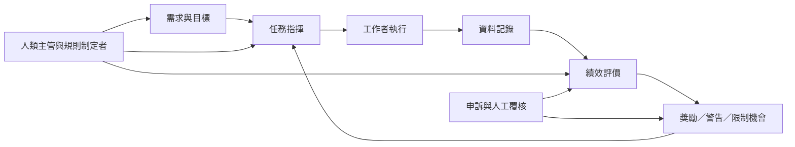

演算法管理的控制流程可分為任務指揮、績效評價與紀律處置。這些環節透過限制、推薦、記錄、評分、替換與獎勵相互連接，構成日常管理架構。理解這張流程圖，有助於從單一工具跳脫，辨認權力如何貫穿工作全程。

本圖連結[[演算法管理]]、[[演算法控制]]、[[聲譽系統]]、[[遊戲化]]、[[數位監控]]、[[演算法透明度]]與[[人類監督]]。可搭配[[指揮評價與紀律是演算法控制的三個主要面向]]、[[聲譽系統把評分轉化為工作機會]]及[[演算法決策必須保留可辨識的責任主體]]閱讀。

## 參考
* [[六種演算法控制機制涵蓋限制推薦記錄評分替換與獎勵]]；[[外送平台的演算法控制強度會因平台制度而異]]。
* [[Algorithmic_management]]。