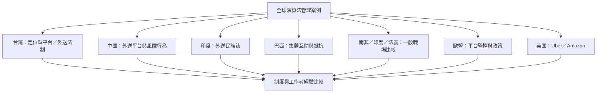

不同地區的演算法管理由平台模式、產業結構、工作者組織與法律制度共同塑造。跨國研究應同時納入平台工作與一般企業職場，也要納入高技能遠距工作、物流、醫療與倉儲。

本圖連結各地資料：[[台灣487名定位型平台工作者調查連結勞動控制與心理福祉]]、[[台灣外送專法自2026年7月21日起施行並規範派單透明與契約保障]]、[[中國長沙外送員問卷研究發現演算法管理對風險行為存在雙重路徑]]、[[印度海德拉巴外送平台田野研究揭示遠端監督與計件勞動]]、[[巴西坎皮納斯百名外送員訪談呈現演算法不透明與集體抵抗]]、[[ILO與歐盟比較法義印南非物流醫療職場發現制度會調節演算法管理影響]]、[[歐洲線上平台工作者也受到時間通訊與螢幕監控]]及[[Uber司機研究顯示資訊不對稱本身就是平台控制資源]]。

## 參考
* [[2026年全球零工經濟文獻回顧指出研究仍偏重西方案例]]；[[演算法管理研究需要避免以英語西方樣本代替全球經驗]]。
* [[Algorithmic_management]]。