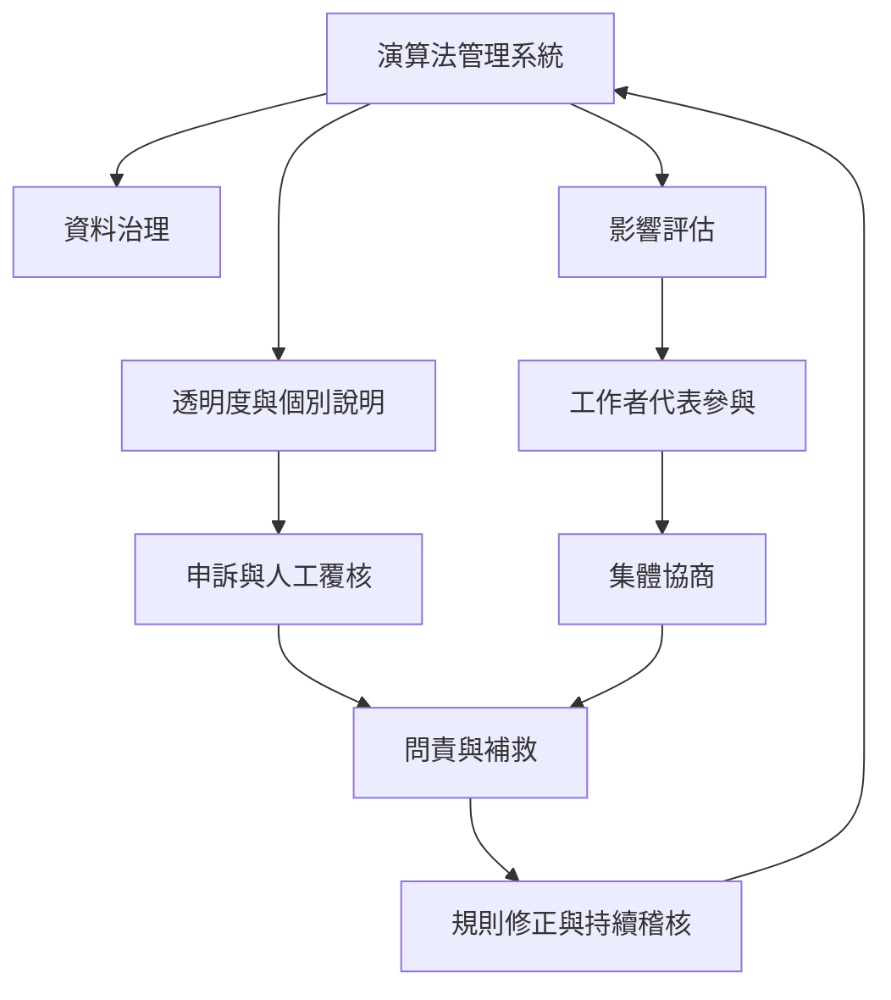

制度治理要處理的是資料權力、演算法透明度、決策可爭議性、人類監督、問責與集體協商。有效治理不必公開全部程式碼，但必須讓受影響者理解個別決策、取得救濟，並讓工作者代表參與系統評估與規則協商。

本圖連結[[資料治理]]、[[演算法透明度]]、[[人類監督]]、[[集體協商]]、[[問責]]與[[自動化決策系統]]。政策案例可比較[[台灣外送專法自2026年7月21日起施行並規範派單透明與契約保障]]與[[歐盟平台工作指令要求人類監督與自動化決策覆核]]。

## 參考
* [[2025年OECD調查顯示演算法管理已廣泛進入企業]]；[[ILO研究指出平台工作者需要以集體協商縮小演算法資訊落差]]。
* [[Algorithmic_management]]。