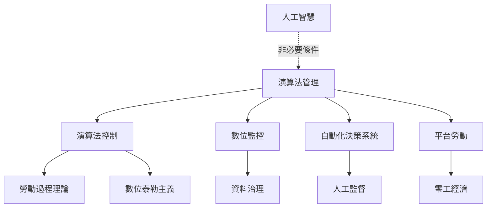

演算法管理的研究起點是辨認管理職能如何由軟體承擔，並把技術放回勞動過程、組織控制與資料權力的脈絡。它不等於人工智慧，也不等於數位監控；平台勞動是重要案例，但不是唯一場域。

本圖串聯[[演算法管理]]、[[演算法控制]]、[[數位監控]]、[[平台勞動]]、[[零工經濟]]、[[人工智慧]]、[[自動化決策系統]]、[[勞動過程理論]]、[[數位泰勒主義]]、[[資料治理]]與[[人類監督]]。深入閱讀可從[[演算法管理是一套管理權能的組合而不是單一監控工具]]與[[演算法管理不必依賴人工智慧也能成立]]開始。

## 參考
* [[演算法管理已從平台工作延伸至物流醫療與一般職場]]；[[六種演算法控制機制涵蓋限制推薦記錄評分替換與獎勵]]。
* [[Algorithmic_management]]。