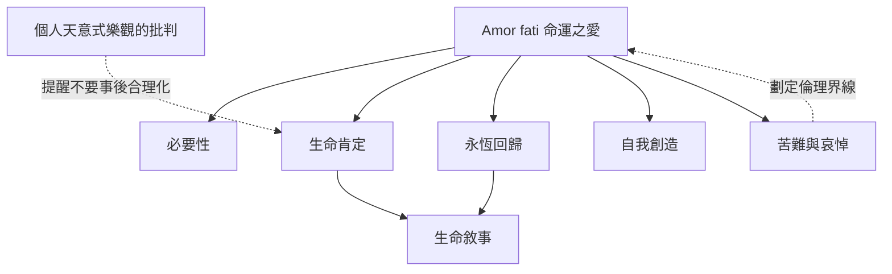

本圖以尼采文本為中心，呈現 Amor fati 與生命肯定、必要性、永恆回歸及自我形成的關係。圖中的連線表示概念上的關聯，不代表單一、固定的解釋。研究爭論尤其集中在「愛」的性質、命運的範圍，以及永恆回歸究竟是宇宙論還是思想實驗。

閱讀時可先從[[《快樂的科學》§276：尼采首次在出版著作中提出 Amor fati]]進入，再讀[[《瞧！這個人》：尼采把命運之愛推向不願任何事有所不同]]，最後對照 [[Huddleston 2025：尼采命運之愛中的愛是擁抱並安居於命運]]、[[Han-Pile 2011：命運之愛面臨愛上苦難與愛是否徒然的悖論]]與[[Stern 2013：理解命運之愛必須放回《快樂的科學》的上下文]]。

## 思與行
* 研究每條線時，註明它是尼采原文、學者詮釋，還是本書的延伸整理。
* 將[[命運之愛的倫理界線是承認而不合理化傷害]]放在核心概念旁，避免把肯定變成替傷害辯護。

## 參考
* [[Nolt 2008：永恆回歸如何連結 Amor fati 與對生命的肯定]]。
* [[自我創造始於承認自己的生成條件]]。
