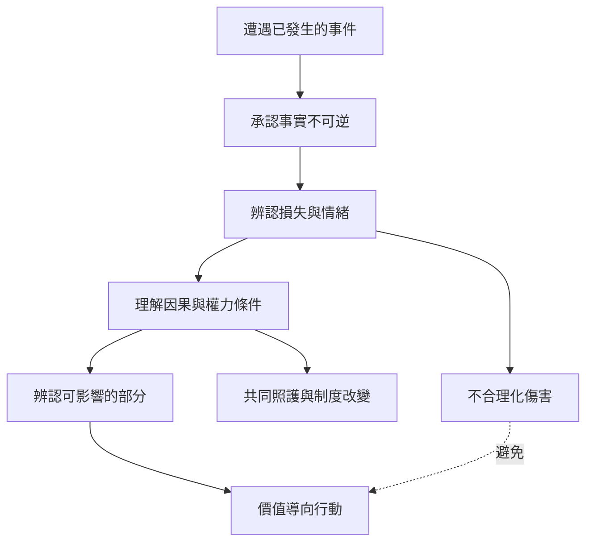

本圖把命運之愛轉化為可討論的實踐步驟，同時保留它的倫理限制：承認事實、容許哀悼、理解條件、辨認能動性、依價值行動；而不是美化創傷、免除加害者責任，或將結構問題個人化。

實踐可以從[[用三欄日記分清已發生之事、受傷之處與下一步行動]]開始，也可以用[[把自責改寫成因果地圖，從中找出可改變的槓桿]]及[[步行時練習對事實說是，對不公說不]]延伸。若困境涉及集體條件，則參照[[以共同照護回應個人無法獨自改變的命運條件]]。

## 思與行
* 每次練習前先確認當事人是否處於安全情境；若仍有正在發生的危險，優先求助與保護，而非進行命運肯定練習。
* 把「接納」的對象說清楚：接納內在經驗、承認既成事實，不等於認同傷害或不公。

## 參考
* [[Macri 與 Rogge 2024：心理彈性是接納與承諾治療的重要作用機制]]。
* [[命運之愛的倫理界線是承認而不合理化傷害]]。
* [[肯定生命必須容許哀悼，而非美化創傷]]。
