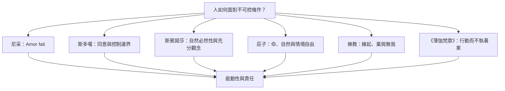

本圖並列不同傳統對命運與能動性的處理方式。它不是把各傳統放在同一條思想演化線上，而是標出可比較的問題：因果是否必然、行動如何可能、限制如何被理解，以及自由指向什麼。

尼采著重生命肯定；斯多噶重視判斷與行動的邊界；斯賓諾莎透過理解原因提升行動能力；莊子重視價值鬆動及回應情境；佛教緣起以條件性理解現象與苦；《薄伽梵歌》則在法與瑜伽脈絡中談行動與果。各自的宗教、倫理與形上學背景不可省略。

## 思與行
* 使用「相似問題／不同核心／不可等同處」三欄整理每一組比較。
* 以[[命運之愛不是一種跨文化通用的同義詞]]作為比較原則。

## 參考
* [[Epictetus《手冊》第一章：先辨別哪些事操之在己]]。
* [[斯賓諾莎《倫理學》研究導讀：理解必然性以轉化被動情感]]。
* [[Lai 2021：莊子在限制之中重新理解自由與命]]。
* [[佛教緣起與業果不能被化約為命定論]]。
* [[《薄伽梵歌》2.47：行動而不執著於結果，不等於消極不作為]]。
