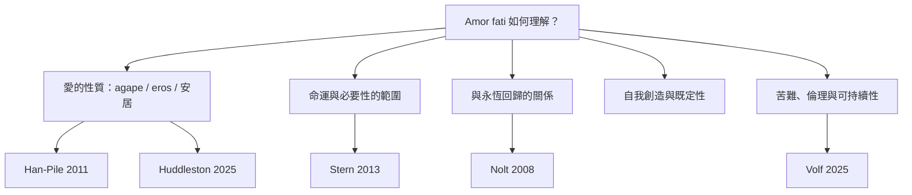

本圖整理 Amor fati 的主要學術爭論：愛的性質、命運的範圍、永恆回歸的功能、自我創造是否與既定性矛盾，以及命運肯定如何面對苦難。各論點是研究方向，不代表作者彼此完全同意。

研究順序建議：先讀[[Stern 2013：理解命運之愛必須放回《快樂的科學》的上下文]]建立文本敏感度，再讀[[Han-Pile 2011：命運之愛面臨愛上苦難與愛是否徒然的悖論]]與[[Huddleston 2025：尼采命運之愛中的愛是擁抱並安居於命運]]，最後比較[[Nolt 2008：永恆回歸如何連結 Amor fati 與對生命的肯定]]與[[自我創造始於承認自己的生成條件]]。

## 思與行
* 讀每篇研究時，摘要作者主張、論證方式與其承認的限制，不要只記結論。
* 把自己的立場標記為暫定，允許新材料修正。

## 參考
* [[Elgat 2016：命運之愛是一種學習看見美的實踐]]。
* [[Volf 2025 Gifford Lecture：對尼采普遍肯定與苦難的神學批判]]。
