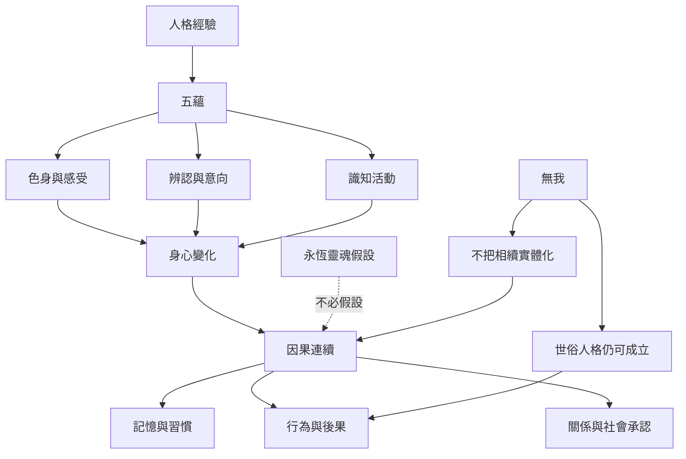

五蘊提供對身心經驗的分析；人格連續則需要說明不同時刻的身心如何形成因果關係。無我否定永恆主體，不必否定語言、責任、記憶或業果。佛教史上出現多種相續模型，應比較其問題意識與歷史位置。

主要研究：[[《Selfless Persons》從上座部傳統重建無我的文化與思想背景]]、[[《Identity and Experience》把五蘊視為經驗構成而非靈魂容器]]、[[《The Selfless Mind》分析早期佛教中的人格、意識與涅槃]]、[[《自我與個人同一性》呈現佛教無我思想的哲學爭論]]。

概念：[[五蘊]]、[[人格同一性]]、[[世俗我]]、[[識]]、[[業]]、[[阿賴耶識]]、[[緣起]]。

永久筆記：[[沒有永恆自我仍可談人格與因果連續]]、[[無我不是否定日常人格與道德責任]]。

延伸：[[把自傳敘事當成可更新的生命模型]]、[[人工智慧的自我模型只能作為無我的有限類比]]。
