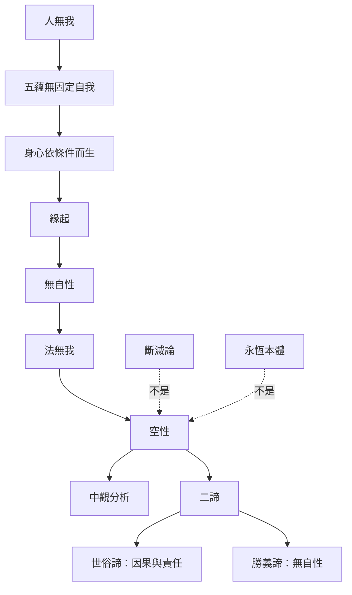

大乘中觀把對個人自我的分析推進為對一切法自性的檢視。它並非否定現象，而是指出事物不依自身本質獨立成立。二諦說明世俗因果與勝義空性不是兩個互斥世界。

研究入口：[[《Nāgārjuna》梳理中觀如何以空性批判自性]]、[[《Emptiness》說明無我與大乘空性之間的思想連結]]、[[《Fundamental Wisdom of the Middle Way》教學呈現藏傳自性與世俗我的區分]]。

概念：[[無我]]、[[緣起]]、[[空性]]、[[自性]]、[[二諦]]、[[中道]]、[[涅槃]]。

永久筆記：[[中觀把無我擴展為一切法無自性]]、[[空性不是虛無而是緣起的另一種表述]]、[[唯識以阿賴耶識說明相續但不等同永恆自我]]。

延伸：[[比較不同傳統如何以不同語言表達非我]]。
