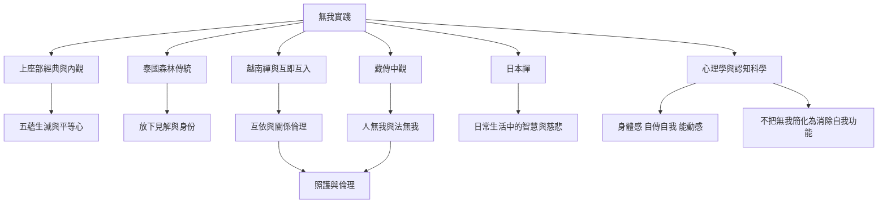

無我在不同傳統中不只是一句定義，也形成不同的修行方法、倫理實踐與研究問題。泰國森林傳統重視放下見解，Goenka 內觀以感受觀察切入，越南禪以互即互入連結慈悲，藏傳中觀分析自性，現代心理學則需要精確區分不同自我功能。

跨傳統材料：[[《Anatta Three Takes》訪談三位當代佛教教師的不同觀點]]、[[《Master of Meditation》訪談 Goenka 說明內觀與無我的關係]]、[[《The Teachings of Ajahn Chah》以放下見解作為無我實踐]]、[[《This Is the Buddha’s Love》訪談以非我與互即互入說明關係]]、[[《Japanese Zen Buddhist Philosophy》呈現禪宗以日常生活實踐智慧]]。

現代研究：[[《Self-related processing removal or revision》檢視正念療效與無我的連結]]、[[《Being No One》提出自我作為透明的現象模型]]、[[《Wrongdoing without a wrongdoer》探討無我與慈悲正義]]。

概念：[[慈悲]]、[[互依]]、[[內觀]]、[[正念]]、[[現象自我模型]]。

行動：[[由無我轉向互賴照護而不是自我消融]]、[[批評行為而不把行為者定型為本質]]、[[以修行中的我是感作為無我研究的田野入口]]。
