無我主題可以從經典論證、禪修觀察與解脫方向三條線閱讀。經典由五蘊切入，觀察身心不受完全主宰；實踐上辨識我所、我見與我是感；結果則是減少貪愛與執取。緣起避免無我被誤解成虛無。

```mermaid
flowchart TD
  A[無我 Anattā] --> B[五蘊分析]
  A --> C[觀察不可主宰]
  B --> D[色 受 想 行 識]
  D --> E[無常]
  D --> F[苦與不滿足]
  C --> G[這不是我的]
  C --> H[這不是我]
  C --> I[這不是我的自我]
  G --> J[鬆動我所執取]
  H --> K[鬆動自我見]
  I --> L[鬆動我是感]
  J --> M[離貪與解脫]
  K --> M
  L --> M
  N[緣起] --> A
  N --> O[中道：不落常見與斷見]
```

經典入口：[[《無我相經》以五蘊檢驗身心是否能作主]]、[[《奇哉經》指出「我是」的習慣可能晚於明確我見消退]]、[[《迦旃延氏經》以緣起避開存在與不存在的兩端]]。

可用概念：[[無我]]、[[五蘊]]、[[無常]]、[[苦]]、[[取]]、[[我慢]]、[[離貪]]。

永久筆記：[[五蘊皆是條件所生的過程而不是恆常主體]]、[[無我觀察需要同時鬆開我所我見與我是感]]、[[無我是一種觀察與放下執取的方法]]。

延伸行動：[[用三句提問觀察每一次我是感如何形成]]、[[檢查自己是否把無我變成新的成就身份]]。
