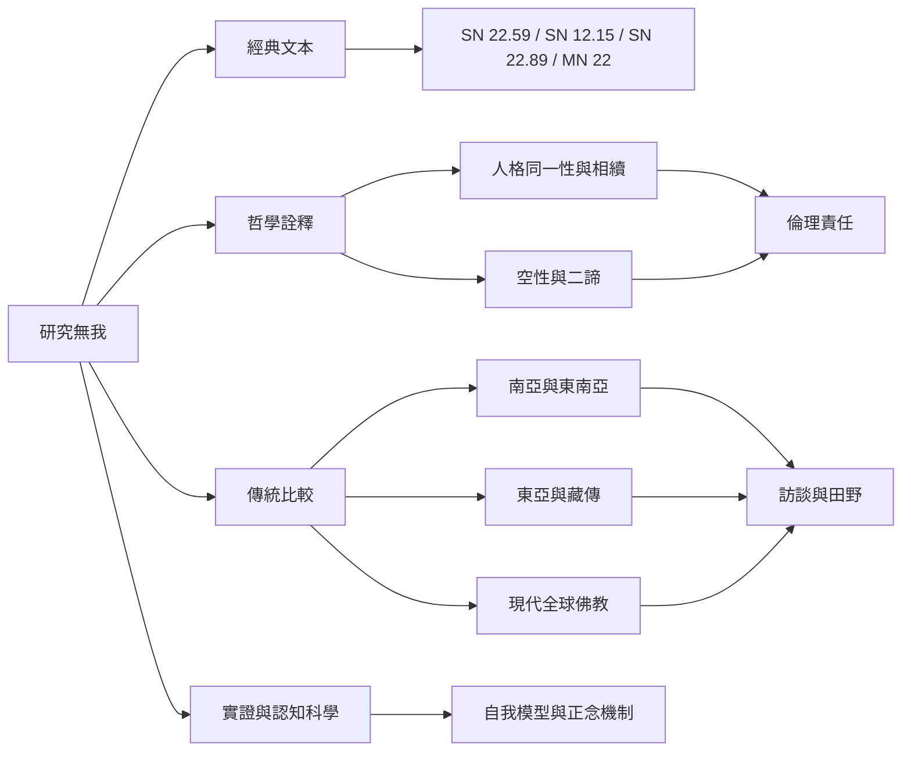

這張地圖把主題拆成可持續研究的問題：無我究竟否定什麼？五蘊如何說明經驗？沒有靈魂如何理解業果？無我如何與空性、慈悲、倫理及認知科學對話？不同傳承的說法有哪些共同點與不可互換之處？

文獻卡：[[《無我相經》以五蘊檢驗身心是否能作主]]、[[《迦旃延氏經》以緣起避開存在與不存在的兩端]]、[[《自我與個人同一性》呈現佛教無我思想的哲學爭論]]、[[《Anatta Three Takes》訪談三位當代佛教教師的不同觀點]]。

可持續研究：[[無我訪談應追問經驗變化而非只收集教義口號]]、[[比較不同傳統如何以不同語言表達非我]]。

概念：[[無我]]、[[人格同一性]]、[[空性]]、[[田野研究]]、[[民族誌]]、[[正念]]。
