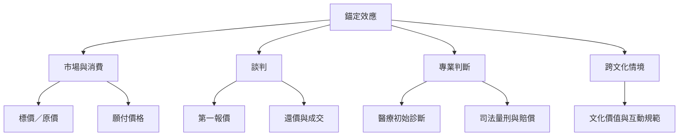

錨定效應在不同實務領域呈現不同形式：消費者可能受原價或建議價格牽引；談判者可能受第一個報價影響；醫療人員可能過度依賴初始診斷標籤；法官可能受到不相關數字參照點影響。應用研究不能直接互換，因為每個領域的資訊品質、責任結構與決策程序不同。

## 閱讀路徑
* 消費：[[消費者願付價格會受與交易不確定性相關的錨點影響]]、[[消費者看到原價與折扣標示時可能改變價格參照點]]。
* 談判：[[第一個報價會牽引談判結果但換位思考能削弱錨定]]、[[2025談判統合分析指出高企圖首報價有收益也有代價]]。
* 專業情境：[[臨床分診的初始診斷標籤可能改變後續檢查行為]]、[[司法量刑與損害賠償會受不相關數字參照點影響]]。
* 文化：[[十國資料顯示錨定效應會隨文化價值取向而異]]。
