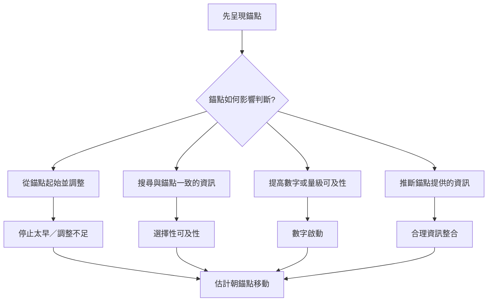

錨定效應不是單一機制的同義詞。調整不足描述從起點移動不夠；選擇性可及性描述錨點引導資訊搜尋；數字啟動描述數字可及性提高；而錨點也可能帶有合理資訊訊號。不同任務的錨定機制可能不同，研究應透過可區分的預測來比較。

## 閱讀路徑
* 從[[調整不足是一種解釋而不是所有錨定效應的總模型]]開始。
* 接著讀[[選擇性可及性說明錨點如何改變搜尋方向]]與[[選擇性可及性理論的關鍵測試未能穩定複現]]。
* 再讀[[錨定整合模型提供描述錨定強度的量化方式]]，注意模型描述與因果機制的差異。

## 概念連結
[[錨定效應]]、[[調整不足]]、[[選擇性可及性]]、[[數字啟動]]、[[參照點]]、[[錨點]]。
