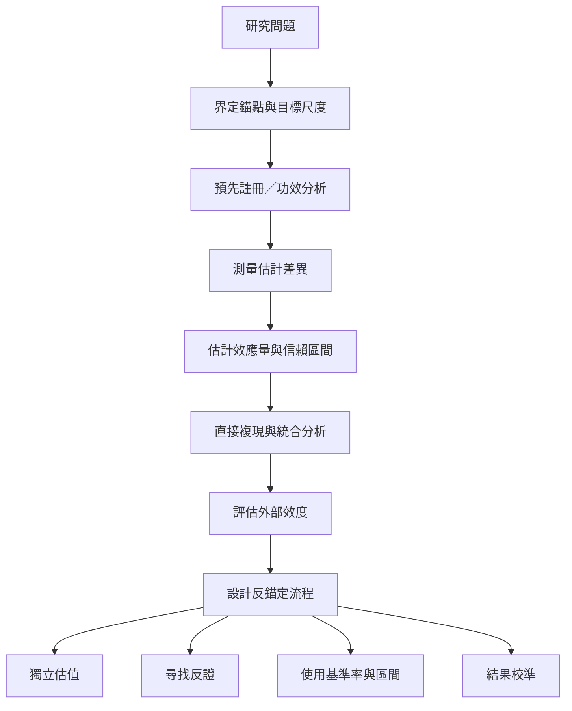

研究錨定效應時，必須區分現象是否存在、效應大小、作用機制與實務外推。樣本小、檢定力不足、出版偏誤與機制測試不充分，都可能讓結論過度確定。反錨定則可透過資訊順序、獨立估值、反證檢查、基準率與校準紀錄等流程改善。

## 閱讀路徑
* 證據綜述：[[五十年統合分析顯示數字錨定整體效應大但高度異質]]。
* 方法警訊：[[高檢定力複現提醒研究者不要高估錨定效應大小]]、[[選擇性可及性理論的關鍵測試未能穩定複現]]。
* 反錨定：[[反錨定的起點是先做獨立估計再看外部數字]]、[[有誘因與校準程序可降低但不能保證消除錨定]]。

## 概念連結
[[基準率]]、[[校準]]、[[認知反思]]、[[錨定整合模型提供描述錨定強度的量化方式]]。
