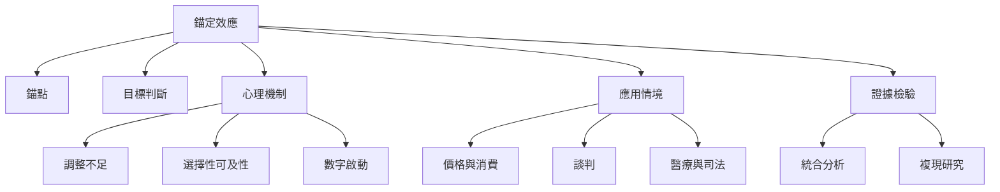

錨定效應是一種判斷現象：先前出現的數字或參照資訊，可能牽引後續數量與價值估計。要理解它，須同時追蹤效應定義、錨點種類、心理機制、任務邊界與反錨定方法。

閱讀入口：先讀[[錨定效應]]、[[判斷中的不確定性會促使人們依賴初始數字]]，再比較[[調整不足是一種解釋而不是所有錨定效應的總模型]]與[[選擇性可及性說明錨點如何改變搜尋方向]]。最後以[[五十年統合分析顯示數字錨定整體效應大但高度異質]]及[[高檢定力複現提醒研究者不要高估錨定效應大小]]校正整體證據。

## 延伸閱讀
* 概念：[[參照點]]、[[錨點]]、[[基準率]]、[[認知偏誤]]、[[前景理論]]。
* 研究：[[錨定效應的研究跨越四十年且出現在多種判斷領域]]、[[十國資料顯示錨定效應會隨文化價值取向而異]]。
* 應用：[[反錨定的起點是先做獨立估計再看外部數字]]。
