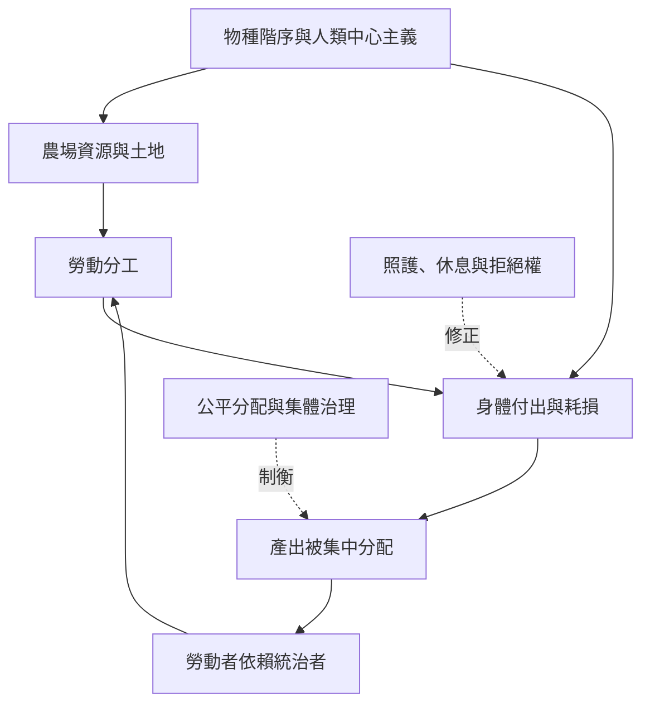

《動物農莊》也呈現動物被當成勞動力與可支配身體的處境。此圖將勞動價值、身體耗損、照護與物種階序放在同一系統中，避免將動物完全還原成政治符號。

## 概念連結
[[note/Boxer 的身體呈現生產力如何把勞動者變成可耗用資源]]；[[note/動物不只是政治符號也承受勞動與物種階序]]；[[term/動物研究]]；[[term/勞動剝削]]；[[moc/政治寓言如何揭露權力集中與革命背叛]]；本書導讀：[[Animal_Farm]]。

本卡亦由 [[idea/為勞動者建立拒絕過勞與取得照護的權利]] 延伸閱讀。

本卡亦由 [[idea/把每個動物角色同時放回政治史與物種倫理中閱讀]] 延伸閱讀。
