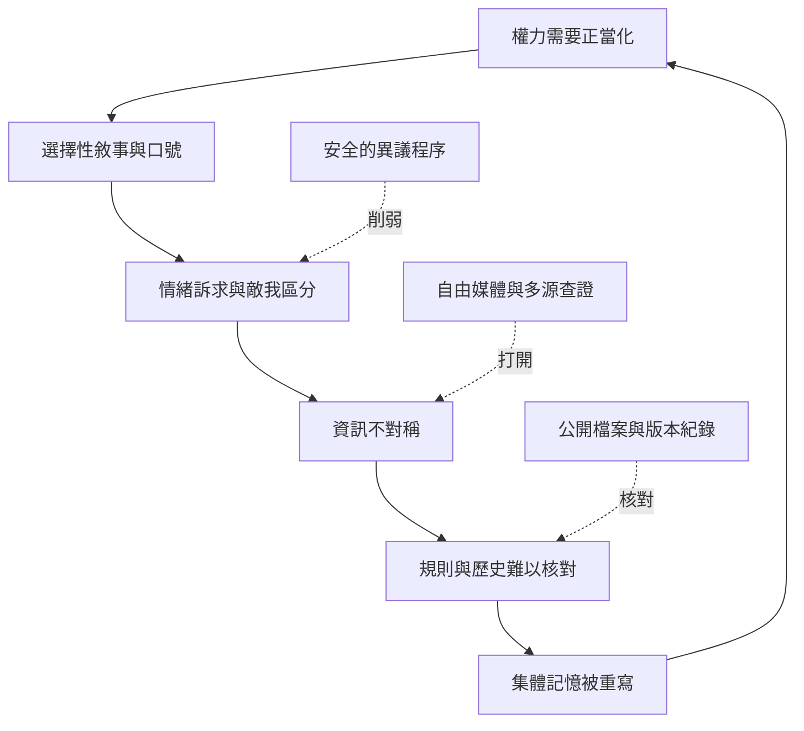

此圖呈現統治權如何透過語言與記憶延續：口號先縮短問題，資訊不對稱降低查證能力，過去再被重新敘述，使現狀看似唯一可能。反制需要可讀的原始紀錄、安全的異議空間與多源查證。

## 概念連結
[[note/政治口號透過縮短語言與限制問題來製造服從]]；[[note/集體記憶需要可查證的紀錄而不是領袖口述]]；[[term/政治宣傳]]；[[term/審查制度]]；[[moc/政治寓言如何揭露權力集中與革命背叛]]；本書導讀：[[Animal_Farm]]。

本卡亦由 [[idea/把共同約定改寫成可追蹤版本的社群章程]] 延伸閱讀。

本卡亦由 [[note/政治宣傳能改寫事件也能規定人們應該如何感受]] 延伸閱讀。

本卡亦由 [[idea/以多源交叉核對建立社群的集體記憶]] 延伸閱讀。

本卡亦由 [[note/宣傳成功與否取決於資訊環境及受眾既有信念]] 延伸閱讀。

本卡亦由 [[note/審查可以在正式禁令出現之前由自我審查完成]] 延伸閱讀。

本卡亦由 [[idea/讓共同決策的每項主張都附上證據與不確定性]] 延伸閱讀。

本卡亦由 [[note/識字與教育落差會讓規則修改變得難以察覺]] 延伸閱讀。
