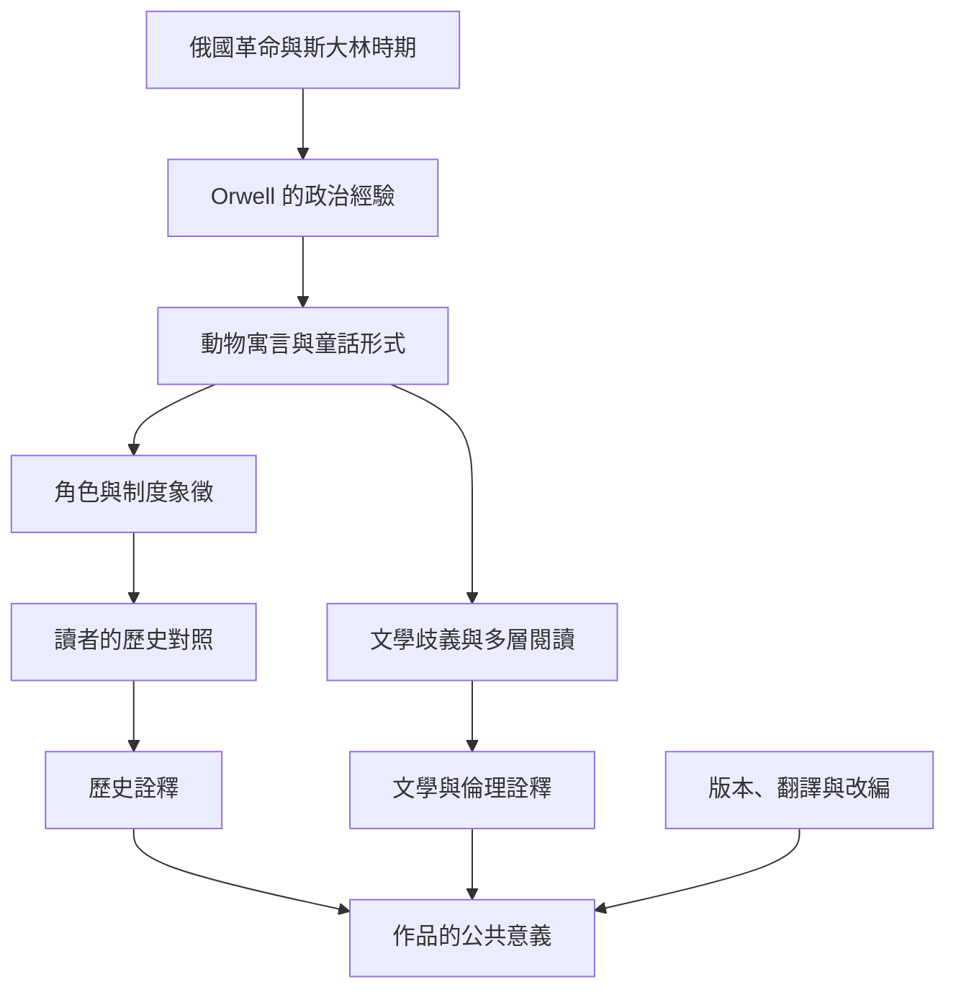

此圖將小說的歷史來源、文學形式與後續解讀分開，再呈現它們如何互相影響。角色可與革命史人物形成參照，但小說不是逐項歷史紀錄；童話與寓言形式同時增加可讀性、諷刺效果與解釋空間。

## 概念連結
[[note/歷史寓言的角色對照應視為近似關係而非逐項密碼]]；[[note/政治寓言的藝術形式會保留超出歷史對照表的意義]]；[[term/寓言]]；[[term/歷史寓言]]；[[moc/政治寓言如何揭露權力集中與革命背叛]]；本書導讀：[[Animal_Farm]]。

本卡亦由 [[idea/為公共閱讀建立三條互補的閱讀路徑]] 延伸閱讀。

本卡亦由 [[moc/翻譯、改編與不同社會的閱讀位置]] 延伸閱讀。

本卡亦由 [[note/簡單寓言能以低門檻故事承載複雜的政治批判]] 延伸閱讀。
