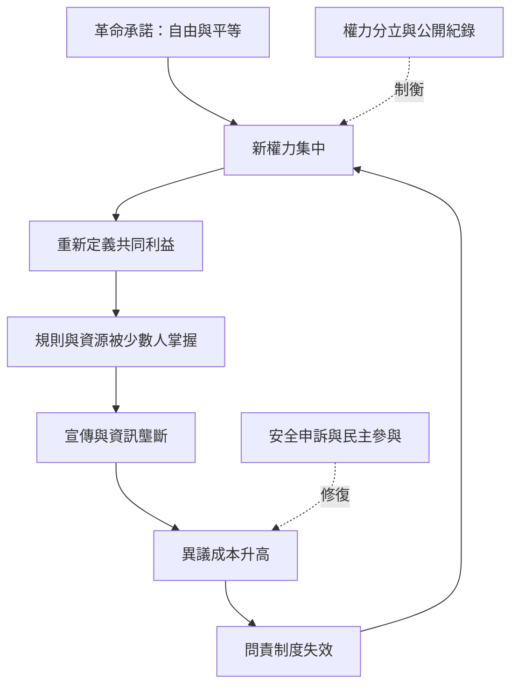

《動物農莊》把革命承諾、制度變動與統治者自我豁免連成因果鏈。此圖聚焦共同價值如何被重新定義、異議如何被壓制，以及缺少制衡時政治理想如何被權力占有。

## 概念連結
[[note/《動物農莊》批判斯大林主義不等於否定民主社會主義]]；[[note/革命後的統治者可能以重新定義共同利益來正當化特權]]；[[note/平等口號必須落實為可檢查的分配與問責制度]]；[[term/極權主義]]；[[term/政治平等]]；[[moc/宣傳、語言與集體記憶如何維持支配]]；本書導讀：[[Animal_Farm]]。

本卡亦由 [[idea/為共同生活設計一份能防止權力集中的七項檢核表]] 延伸閱讀。

本卡亦由 [[note/領導者的問責必須包含對強制力的制度限制]] 延伸閱讀。

本卡亦由 [[idea/為公共閱讀建立三條互補的閱讀路徑]] 延伸閱讀。

本卡亦由 [[idea/練習把異議當成公共查證而不是忠誠考驗]] 延伸閱讀。

本卡亦由 [[moc/小說如何把俄國革命史轉化成可重讀的寓言]] 延伸閱讀。

本卡亦由 [[moc/動物身體、勞動與物種階序]] 延伸閱讀。

本卡亦由 [[note/恐懼與暴力讓公開討論失去實際意義]] 延伸閱讀。
