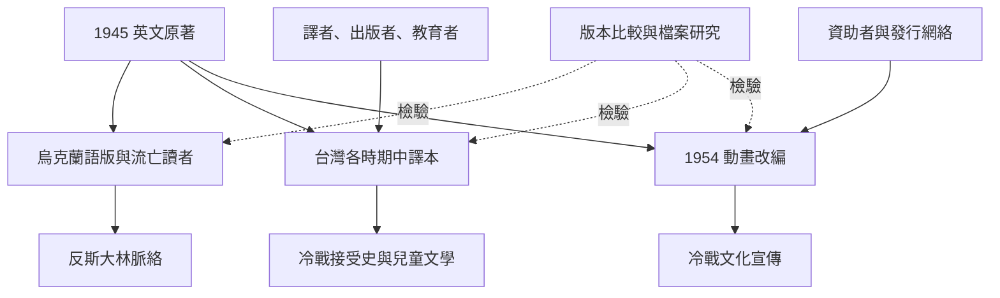

作品從英國原著流通至烏克蘭、台灣與冷戰電影市場時，會經過翻譯、出版選擇、讀者定位及政治徵用。比較版本既要注意語言變化，也要追蹤資助、發行及教育用途。

## 概念連結
[[note/翻譯與出版副文本會共同塑造作品的公共生命]]；[[note/改編一旦改變結尾就可能改變政治責任的想像]]；[[term/接受史]]；[[term/翻譯研究]]；[[moc/小說如何把俄國革命史轉化成可重讀的寓言]]；本書導讀：[[Animal_Farm]]。

本卡亦由 [[note/作品被禁或被挑戰的理由會反映當地政治與教育制度]] 延伸閱讀。

本卡亦由 [[idea/製作原著與改編版的逐幕比較讀書會]] 延伸閱讀。

本卡亦由 [[note/反宣傳作品也可能被另一套宣傳機器重新徵用]] 延伸閱讀。

本卡亦由 [[idea/以不同地區的譯本追蹤同一作品的政治生命]] 延伸閱讀。

本卡亦由 [[note/台灣兒童版翻譯揭示讀者年齡會改變寓言的政治可見度]] 延伸閱讀。
