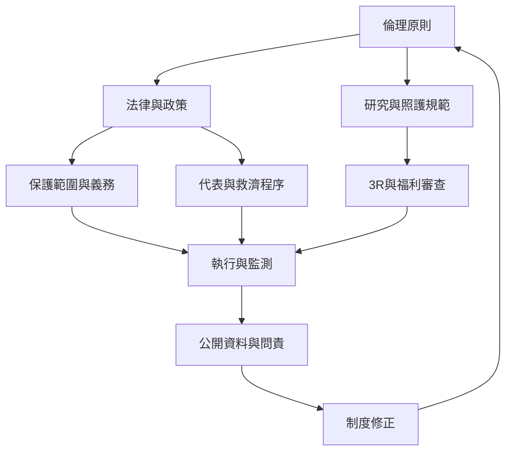

動物倫理只有進入制度，才能影響研究、飼養、運輸、屠宰、收容、保育與日常消費。法律可確立保護對象與義務，政策指標可比較不同國家的制度，但法條與排名都不能取代地方執行、個案調查及動物實際處境。有效治理需要代表機制、資源、透明資料與可追蹤的救濟程序。

相關永久筆記：[[法律承認動物是感受者仍需配套代表權與執行機制]]、[[研究使用動物的舉證責任應隨替代方案成熟而提高]]、[[人類善待動物的倫理不能只限於伴侶動物]]。來源脈絡包括[[台灣動物保護法以尊重生命與增進福利作為立法目的]]、[[拉丁美洲法院正以憲法解釋擴展動物與自然的法律保護]]與[[跨國動物保護指標適合比較制度但不能代替在地脈絡]]。概念入口為[[動物倫理]]、[[動物福利]]、[[動物權利]]與[[自然權利]]。並與[[感知科學與福利評估]]、[[生態正義與保育衝突]]相連。
